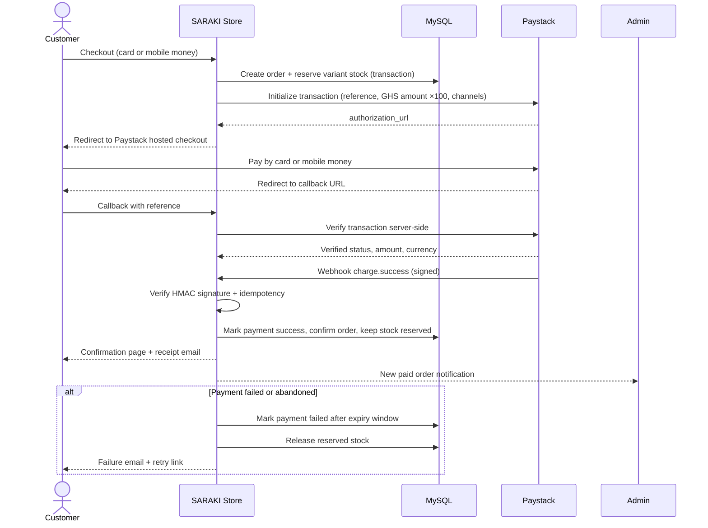

# SARAKI Digital Platform — Entity Relationship Diagram (v1)

| Field | Value |
|---|---|
| Task | 0.4 — Produce the ERD |
| Version | 0.2 — Updated for Ghana/GHS |
| Date | 2026-11-05 |
| Scope | v1 with product variants and Paystack payments (Ghana/GHS) |
| Status | In review |

> The diagrams below use Mermaid. They render in GitHub, GitLab, VS Code (Mermaid extension), and Qoder's Markdown preview.

---

## 1. Entity relationship diagram

```mermaid
erDiagram
    USERS ||--o{ CARTS : "owns"
    USERS ||--o{ ORDERS : "places"
    USERS ||--o{ APPOINTMENTS : "books"
    USERS ||--o{ WISHLISTS : "saves"
    USERS ||--o{ BLOG_POSTS : "authors"
    USERS ||--o{ ORDER_STATUS_HISTORY : "changes"
    USERS ||--o{ REFUNDS : "processes"

    CATEGORIES ||--o{ PRODUCTS : "contains"
    CATEGORIES ||--o{ CATEGORIES : "parent of"

    PRODUCTS ||--o{ PRODUCT_VARIANTS : "has"
    PRODUCTS ||--o{ PRODUCT_IMAGES : "has"
    PRODUCTS ||--o{ CART_ITEMS : "referenced in"
    PRODUCTS ||--o{ ORDER_ITEMS : "referenced in"
    PRODUCTS ||--o{ WISHLISTS : "saved in"

    PRODUCT_VARIANTS ||--o{ CART_ITEMS : "selected as"
    PRODUCT_VARIANTS ||--o{ ORDER_ITEMS : "selected as"

    CARTS ||--o{ CART_ITEMS : "contains"

    ORDERS ||--o{ ORDER_ITEMS : "contains"
    ORDERS ||--o{ ORDER_STATUS_HISTORY : "has"
    ORDERS ||--o{ PAYMENTS : "paid by"

    PAYMENTS ||--o{ REFUNDS : "refunded by"
    PAYMENTS ||--o{ PAYMENT_EVENTS : "logs"

    APPOINTMENT_SERVICES ||--o{ APPOINTMENTS : "booked as"

    USERS {
        bigint id PK
        string name
        string email UK
        string phone
        string password
        enum role "admin, customer"
        string locale "fr, en"
        timestamp email_verified_at
        timestamp created_at
        timestamp updated_at
    }

    CATEGORIES {
        bigint id PK
        bigint parent_id FK
        string name_fr
        string name_en
        string slug UK
        int sort_order
        boolean is_active
        timestamp created_at
        timestamp updated_at
    }

    PRODUCTS {
        bigint id PK
        bigint category_id FK
        string name_fr
        string name_en
        string slug UK
        text description_fr
        text description_en
        decimal base_price
        string base_sku UK
        boolean is_active
        boolean is_featured
        timestamp created_at
        timestamp updated_at
    }

    PRODUCT_VARIANTS {
        bigint id PK
        bigint product_id FK
        string size
        string color
        string sku UK
        int stock_qty
        decimal price_delta
        boolean is_active
        timestamp created_at
        timestamp updated_at
    }

    PRODUCT_IMAGES {
        bigint id PK
        bigint product_id FK
        string path
        string alt_fr
        string alt_en
        int sort_order
        boolean is_primary
    }

    CARTS {
        bigint id PK
        bigint user_id FK
        string session_id
        timestamp created_at
        timestamp updated_at
    }

    CART_ITEMS {
        bigint id PK
        bigint cart_id FK
        bigint product_id FK
        bigint variant_id FK
        int quantity
        decimal unit_price
        timestamp created_at
        timestamp updated_at
    }

    WISHLISTS {
        bigint id PK
        bigint user_id FK
        bigint product_id FK
        timestamp created_at
    }

    ORDERS {
        bigint id PK
        bigint user_id FK
        string order_number UK
        enum status "pending, confirmed, in_production, ready, delivered, cancelled"
        enum payment_status "unpaid, pending, paid, failed, refunded, partially_refunded"
        enum payment_method "paystack, cod, transfer"
        decimal subtotal
        decimal shipping_fee
        decimal total
        string currency "GHS (configurable)"
        string delivery_name
        string delivery_phone
        string delivery_address
        string delivery_city
        text notes
        timestamp placed_at
        timestamp completed_at
        timestamp created_at
        timestamp updated_at
    }

    ORDER_ITEMS {
        bigint id PK
        bigint order_id FK
        bigint product_id FK
        bigint variant_id FK
        string product_name "snapshot"
        string variant_label "snapshot"
        decimal unit_price "snapshot"
        int quantity
        decimal line_total
    }

    ORDER_STATUS_HISTORY {
        bigint id PK
        bigint order_id FK
        enum status
        text note
        bigint changed_by FK
        timestamp created_at
    }

    PAYMENTS {
        bigint id PK
        bigint order_id FK
        string provider "paystack"
        string reference UK
        string provider_reference
        decimal amount
        string currency "GHS (configurable)"
        string channel "card, mobile_money, bank_transfer"
        enum status "initialized, pending, success, failed, abandoned, refunded, partially_refunded"
        timestamp paid_at
        json gateway_response
        timestamp created_at
        timestamp updated_at
    }

    PAYMENT_EVENTS {
        bigint id PK
        bigint payment_id FK
        string provider "paystack"
        string event_id UK
        string event_type
        string reference
        json payload
        boolean signature_valid
        timestamp processed_at
        timestamp created_at
    }

    REFUNDS {
        bigint id PK
        bigint payment_id FK
        decimal amount
        text reason
        string provider_reference
        enum status "pending, success, failed"
        bigint processed_by FK
        timestamp created_at
    }

    APPOINTMENT_SERVICES {
        bigint id PK
        string name_fr
        string name_en
        int duration_min
        boolean is_active
    }

    WORKING_HOURS {
        bigint id PK
        tinyint day_of_week
        time open_time
        time close_time
        boolean is_closed
    }

    BLOCKED_DATES {
        bigint id PK
        date blocked_date
        string reason
    }

    APPOINTMENTS {
        bigint id PK
        bigint user_id FK
        bigint service_id FK
        date appointment_date
        time start_time
        time end_time
        enum status "pending, approved, rescheduled, cancelled, completed"
        text notes
        text admin_notes
        timestamp created_at
        timestamp updated_at
    }

    GALLERY_ITEMS {
        bigint id PK
        string title_fr
        string title_en
        string category
        string image_path
        int sort_order
        boolean is_published
    }

    BLOG_POSTS {
        bigint id PK
        bigint author_id FK
        string title_fr
        string title_en
        string slug UK
        text excerpt_fr
        text excerpt_en
        text body_fr
        text body_en
        string cover_image
        enum status "draft, published"
        timestamp published_at
        timestamp created_at
        timestamp updated_at
    }

    PAGES {
        bigint id PK
        string slug UK
        string title_fr
        string title_en
        text body_fr
        text body_en
        boolean is_published
        timestamp updated_at
    }

    CONTACT_MESSAGES {
        bigint id PK
        string name
        string email
        string phone
        string subject
        text message
        enum status "new, read, replied, archived"
        timestamp created_at
    }

    SETTINGS {
        bigint id PK
        string key UK
        json value
        timestamp updated_at
    }
```

---

## 2. Entity groups

| Group | Tables | Purpose |
|---|---|---|
| Accounts | `users` | Admin and customer accounts; role and locale. |
| Catalogue | `categories`, `products`, `product_variants`, `product_images` | Product structure, variants, and media. |
| Commerce | `carts`, `cart_items`, `wishlists`, `orders`, `order_items`, `order_status_history` | Cart, wishlist, order lifecycle, and history. |
| Payments | `payments`, `payment_events`, `refunds` | Paystack transactions, webhook idempotency, and refunds. |
| Appointments | `appointment_services`, `working_hours`, `blocked_dates`, `appointments` | Studio calendar and bookings. |
| Content | `gallery_items`, `blog_posts`, `pages`, `contact_messages`, `settings` | CMS, inquiries, and configuration. |

---

## 3. Key constraints and business rules

### Catalogue

- `categories.slug` is unique; `categories.parent_id` supports sub-categories.
- `products.slug` and `products.base_sku` are unique.
- `product_variants.sku` is globally unique.
- `product_variants` has a unique composite key on `(product_id, size, color)`.
- `product_variants.stock_qty` cannot be negative; stock changes run inside transactions with row locks.
- A product may have zero variants only if it is sold as a single SKU; the variant selector hides when no variants exist.

### Cart and orders

- `cart_items` is unique per `(cart_id, variant_id)`; quantity must be at least 1.
- `orders.order_number` is unique and human-readable.
- `order_items` stores **snapshots** of product name, variant label, and unit price so later catalogue edits do not rewrite history.
- `orders.status` and `orders.payment_status` are separate: an order can be `pending` while payment is `paid` only after verification; online orders become `confirmed` after payment success (COD orders confirm immediately).
- `orders` cannot be edited after `delivered` or `cancelled`; only status history may be appended.
- Cancellation restocks the exact `product_variants` row and writes a status-history entry.

### Payments (Paystack)

- `payments.reference` is unique and is the idempotency key for a payment attempt.
- Multiple payment attempts may exist per order; only one may be `success` (enforced in the application transaction).
- `payment_events.event_id` is unique to guarantee webhook idempotency.
- The webhook handler must:
  1. Verify the `x-paystack-signature` HMAC SHA512 using the secret key.
  2. Reject invalid signatures and log them.
  3. Verify the transaction server-side with Paystack before marking paid.
  4. Match amount, currency, and reference to the order.
  5. Return HTTP 200 quickly and avoid duplicate processing.
- Paystack amounts are sent in the smallest unit. **For GHS, multiply the cedi amount by 100 (pesewas).** For a later XOF switch, Paystack also requires multiplying the franc amount by 100.
- `refunds` total must never exceed the successful payment amount.
- Refunds are idempotent and recorded even when initiated manually from the Paystack dashboard.
- Paystack channels in v1: `card` and `mobile_money`. Bank transfer/USSD are optional if enabled on the merchant account.

### Stock reservation

- Stock is **reserved at order creation**, inside a database transaction with `SELECT ... FOR UPDATE` on each `product_variants` row.
- Online orders start as `payment_status = pending`.
- If payment fails or is abandoned, a scheduled job releases the reservation and restocks the variant after the expiry window (default 30 minutes).
- On successful payment, the reservation is committed and `payment_status` becomes `paid`.
- COD orders reserve stock at placement and confirm immediately.
- Refunds do **not** automatically restock; restocking is an explicit cancellation/return action.

### Appointments

- `working_hours` defines the weekly schedule; `blocked_dates` overrides it.
- `appointments` cannot overlap for the single studio calendar. Availability is computed from service duration, working hours, blocked dates, and existing `approved`/`pending` bookings.
- Booking creation uses a transaction and a uniqueness check on `(appointment_date, start_time)` for active statuses.
- Statuses: `pending`, `approved`, `rescheduled`, `cancelled`, `completed`.

### Content

- `blog_posts` requires an author and a `published_at` timestamp when published.
- `pages.slug` is unique.
- `settings.key` is unique; values are typed JSON for store info, fees, Paystack toggles, WhatsApp, and map embeds.

---

## 4. Paystack payment flow

---

## 5. Status enums

| Entity | Values |
|---|---|
| `orders.status` | `pending`, `confirmed`, `in_production`, `ready`, `delivered`, `cancelled` |
| `orders.payment_status` | `unpaid`, `pending`, `paid`, `failed`, `refunded`, `partially_refunded` |
| `payments.status` | `initialized`, `pending`, `success`, `failed`, `abandoned`, `refunded`, `partially_refunded` |
| `refunds.status` | `pending`, `success`, `failed` |
| `appointments.status` | `pending`, `approved`, `rescheduled`, `cancelled`, `completed` |
| `blog_posts.status` | `draft`, `published` |
| `contact_messages.status` | `new`, `read`, `replied`, `archived` |

---

## 6. Deliberately excluded from v1

- `reviews` — deferred to v1.1 per SRS §9 and D-04.
- Multi-currency tables — XOF only in v1 (D-09).
- Multi-vendor tables — not applicable.
- Queue/job tables — no queues in v1; the scheduler handles payment expiry and backups.

---

## 7. Paystack account prerequisite (D-14)

The v1 market is **Ghana (GHS)**. Paystack supports Ghana merchant accounts with card and mobile money (MTN MoMo, Vodafone Cash, AirtelTigo/AT Money). Before Task 3.5, SARAKI must confirm:

- the Paystack Ghana account is active and settled in **GHS**;
- card and mobile money channels are enabled;
- test public/secret keys are available;
- the webhook URL can be configured.

**Later XOF switch:** currency, locale, shipping fees, and Paystack keys are configuration values, so the code does not change. The client must provide a Paystack account/entity enabled for XOF before switching; otherwise an alternative gateway (for example Flutterwave or CinetPay) may be required.

---

## 8. Review checklist

- [ ] All v1 entities and relationships are present.
- [ ] Variants are linked to cart items, order items, and stock rules.
- [ ] Payments, webhook events, and refunds are modelled.
- [ ] Order and payment statuses are clear and separate.
- [ ] Appointment overlap rules are defined.
- [ ] Currency and locale are configuration values; v1 defaults to GHS and French.
- [ ] No v1.1 entity is included by accident.
- [ ] Client approves the ERD at G0-final.
